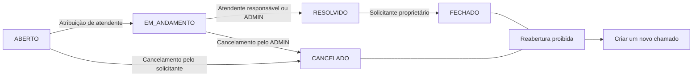
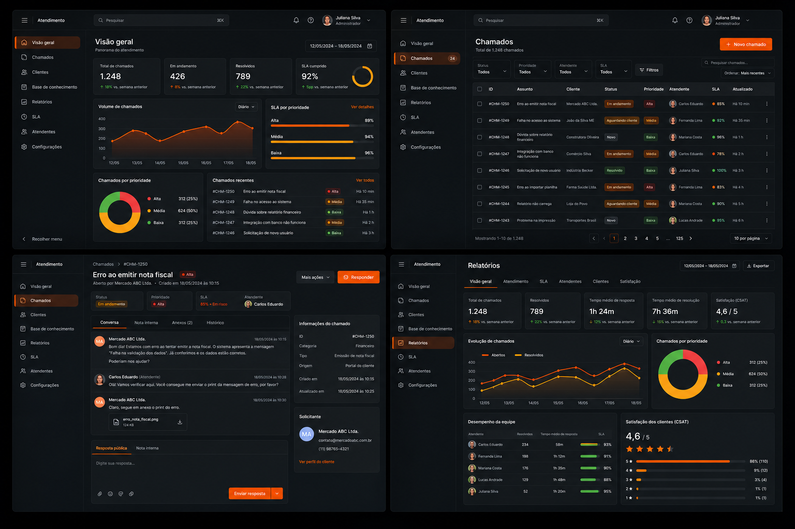

<div align="center">

# SolveIT

### Chamados de suporte com autorização correta, histórico auditável e comunicação clara


</div>

> [!IMPORTANT]
> **Fase 2 em execução.** A base da Fase 1 permanece concluída e verificada, e 2 dos 8 planos de autenticação estão prontos. `POST /api/auth/register` já cadastra somente solicitantes com BCrypt, validação, erros seguros e proteção contra e-mail duplicado; o próximo passo é o Plano 02-03, que inicia a fundação criptográfica do JWT. Login, `/api/auth/me`, demais endpoints, telas, build publicado e deploy continuam planejados.

## O que é o SolveIT

O SolveIT é um sistema web em construção para abertura e gerenciamento de chamados de suporte técnico. Solicitantes poderão registrar e acompanhar problemas, atendentes conduzirão o atendimento e administradores gerenciarão a operação, os usuários, as categorias e os indicadores.

O projeto nasce como uma aplicação educacional construída do zero. Seu valor central é permitir que um chamado percorra todo o ciclo com autorização validada no servidor, comunicação entre os envolvidos e uma trilha de auditoria que explique cada mudança de status.

As entidades centrais planejadas são `Usuario`, `Categoria`, `Chamado`, `Comentario` e `HistoricoStatus`. Os contratos completos estão no [documento de origem](SolveIT_GSD_SystemPrompt.md) e nos [requisitos do v1](.planning/REQUIREMENTS.md).

## Por que o SolveIT

O projeto combina um problema de negócio reconhecível com fundamentos importantes de desenvolvimento web: modelagem relacional, APIs REST, autenticação stateless, autorização contextual, transações, migrações, notificações e uma SPA responsiva.

O objetivo não é apenas chegar a uma aplicação funcional. A abordagem **Build to Learn** exige que cada incremento seja pequeno, explicado e verificável, incluindo o motivo das decisões de Spring Boot e os conceitos de banco de dados usados na solução.

## Estado atual

| Item | Situação |
| --- | --- |
| Estado do repositório | Fase 1 concluída; Fase 2 em execução |
| Fases implementadas | 1 concluída; Fase 2 com 2 de 8 planos completos |
| Progresso do milestone | 14% por fases; 7 de 13 planos conhecidos completos (54%) |
| Foco atual | Fase 2 — Plano 02-03, fundação criptográfica JWT |
| Aplicação executável | Base Spring Boot disponível; execução local exige MySQL configurado |
| API e telas disponíveis | `POST /api/auth/register` disponível; demais endpoints e telas planejados |

A base de persistência e o cadastro público descritos neste README estão implementados e verificados. Login, JWT, autorização completa, regras de chamados, notificações, dashboard e telas permanecem **contratos planejados**, não capacidades já disponíveis.

## Como acompanhar o projeto

- Consulte o [estado atual](.planning/STATE.md) para saber o ponto de continuidade do trabalho.
- Acompanhe a ordem e os critérios de cada incremento no [roadmap](.planning/ROADMAP.md).
- Verifique o escopo e a rastreabilidade nos [requisitos](.planning/REQUIREMENTS.md).
- Leia o [fluxo Git por ticket](docs/GIT-WORKFLOW.md) antes de iniciar uma mudança.

O andamento só deve ser considerado entregue quando os artefatos de planejamento, os testes proporcionais e o histórico Git confirmarem a conclusão. O texto deste README deve evoluir junto com o estado real do repositório.

## Como verificar o back-end atual

Para compilar e executar os testes das entregas atuais no Windows, tenha Java 17 e Docker Desktop com o engine Linux ativo. O Maven Wrapper fixa a versão do Maven do projeto, e o Testcontainers cria bancos MySQL 8.4 temporários para validar persistência, migrações, segurança e cadastro — `DB_USERNAME` e `DB_PASSWORD` não são necessários nesse caminho.

```powershell
Set-Location solveit-api
.\mvnw.cmd clean verify
```

Em Linux ou macOS, use `./mvnw clean verify`. O resultado esperado é `BUILD SUCCESS`; a suíte atual possui 18 testes e valida migrações, constraints, entidades, repositories, cadastro, erros seguros e concorrência contra MySQL real.

Para iniciar a aplicação localmente, crie antes o database `solveit` em uma instância MySQL e forneça as credenciais pelo ambiente. O Flyway cria e versiona as tabelas, mas deliberadamente não cria o database nem armazena credenciais no repositório.

```powershell
$env:DB_USERNAME = '<usuario-local>'
$env:DB_PASSWORD = '<senha-local>'
Set-Location solveit-api
.\mvnw.cmd spring-boot:run
```

`DB_URL` é opcional e, quando omitida, usa `jdbc:mysql://localhost:3306/solveit` com Unicode e UTC. Ainda não há `docker-compose.yml`; Docker é usado automaticamente pelos testes de integração, não pelos testes unitários puros.

## Como funciona

O fluxo planejado começa quando um `SOLICITANTE` abre um chamado em uma categoria ativa. O chamado nasce `ABERTO`, sem atendente, e recebe título, descrição e prioridade. A atribuição de um atendente inicia o trabalho, a resolução registra o momento de conclusão técnica e o solicitante encerra o ciclo ao confirmar o atendimento.

Durante o processo, pessoas autorizadas poderão consultar o detalhe, adicionar comentários e acompanhar o histórico. A API deverá decidir o acesso usando simultaneamente o perfil do usuário e sua relação com o chamado; esconder um botão no front-end nunca será tratado como autorização suficiente.

Cada transição válida deverá atualizar o chamado e criar exatamente um `HistoricoStatus` na mesma transação. Os eventos previstos também alimentarão notificações por e-mail depois da confirmação da transação.

## Perfis e responsabilidades

| Perfil | Responsabilidades planejadas | Limites principais |
| --- | --- | --- |
| `SOLICITANTE` | Cadastrar-se, abrir e acompanhar os próprios chamados, comentar, cancelar um chamado `ABERTO` e fechar um chamado `RESOLVIDO` | Não administra usuários ou categorias; não acessa chamados alheios sem relação permitida |
| `ATENDENTE` | Trabalhar na fila permitida, assumir chamados, comentar e resolver chamados sob sua responsabilidade | Não cria perfis privilegiados; só resolve o chamado atribuído a si, salvo regras de `ADMIN` |
| `ADMIN` | Administrar usuários e categorias, supervisionar chamados, atribuir atendentes, operar transições autorizadas e consultar indicadores | Continua sujeito ao fluxo de status e às invariantes de auditoria |

O cadastro público criará exclusivamente usuários `SOLICITANTE`. Contas `ATENDENTE` e `ADMIN` serão criadas por um administrador para impedir elevação indevida de privilégio.

## Regras críticas

- Apenas solicitantes abrem chamados; todo chamado nasce `ABERTO` e sem atendente.
- A atribuição de um atendente muda o status automaticamente para `EM_ANDAMENTO`.
- Apenas o atendente responsável ou um administrador pode mover `EM_ANDAMENTO` para `RESOLVIDO`.
- Apenas o solicitante proprietário pode mover `RESOLVIDO` para `FECHADO`.
- O solicitante proprietário pode cancelar um chamado `ABERTO`; somente um administrador pode cancelar um chamado `EM_ANDAMENTO`.
- Título e descrição só podem ser editados enquanto o chamado está `ABERTO`, pelo solicitante proprietário ou por um administrador.
- Chamados `FECHADO` ou `CANCELADO` não podem ser reabertos; um novo chamado deve ser criado.
- Comentários são imutáveis: não haverá rota para editar ou excluir comentário.
- Toda mudança de status deve criar exatamente um registro de `HistoricoStatus`, atomicamente com a alteração do chamado.
- Atualizações concorrentes não poderão sobrescrever silenciosamente uma transição já confirmada.

## Fluxo de status



Qualquer transição que não apareça no diagrama deverá ser rejeitada com uma resposta de erro clara.

### Notificações previstas

| Evento confirmado | Destinatários planejados |
| --- | --- |
| Novo chamado `ABERTO` | Administradores |
| Novo chamado `CRITICA` | Administradores, com destaque urgente adicional |
| Atendente atribuído | Atendente e solicitante |
| Status atualizado | Solicitante |
| Novo comentário | Todos os envolvidos, sem destinatários duplicados |

Os envios deverão ocorrer somente após a confirmação da transação. Uma falha de SMTP não poderá desfazer uma alteração válida do chamado; a estratégia definitiva de entrega será decidida no planejamento da Fase 4.

## Stack do projeto

A base de back-end, persistência, migrações e testes da Fase 1 já está implementada. A Fase 2 também entregou a baseline stateless do Spring Security, cadastro público, BCrypt, validação e Problem Details; login, JWT, autorização completa, notificações e front-end continuam planejados.

| Camada | Tecnologias planejadas | Papel no projeto |
| --- | --- | --- |
| Back-end | Java 17, Spring Boot 3, Spring MVC | API REST síncrona em um monólito modular |
| Persistência | MySQL 8, Spring Data JPA, Hibernate | Modelo relacional e acesso a dados |
| Migrações | Flyway | Único responsável por criar e evoluir o esquema |
| Segurança | Spring Security, JWT, BCrypt | Autenticação stateless e autorização no servidor |
| Notificações | JavaMailSender via SMTP | Comunicação dos eventos do chamado |
| Front-end | React, Tailwind CSS, React Router, Axios | SPA responsiva com jornadas por perfil |
| Testes | JUnit, Mockito, MockMvc, Testcontainers MySQL, Vitest e React Testing Library | Verificação de domínio, segurança, persistência e interface |

Segredos de banco, JWT e SMTP deverão vir do ambiente ou de um cofre de segredos; não serão versionados em arquivos de configuração.

## Arquitetura do projeto

O back-end é uma aplicação modular única em Spring Boot. A Fase 1 criou a raiz da aplicação, `entity`, `enums` e `repository`; os dois primeiros planos da Fase 2 adicionaram `config`, `controller`, `dto`, `exception` e `service`. A árvore abaixo representa a organização alvo, e `security` será criado quando a implementação de JWT exigir esse package. A separação por responsabilidade mantém regras de negócio nos services, contratos HTTP nos controllers e persistência nos repositories:

```text
solveit-api/
└── src/main/java/com/solveit/
    ├── config/
    ├── controller/
    ├── dto/
    ├── entity/
    ├── enums/
    ├── exception/
    ├── repository/
    ├── security/
    └── service/
```

- `config`: configuração geral e integrações.
- `controller`: endpoints REST e validação da fronteira HTTP.
- `dto`: requests e responses sem exposição direta das entidades JPA.
- `entity` e `enums`: modelo persistente e vocabulário do domínio.
- `exception`: erros consistentes, sem stack traces ou segredos nas respostas.
- `repository`: consultas JPA, paginação, filtros e agregações executadas no banco.
- `security`: filtro JWT, identidade autenticada e regras de acesso.
- `service`: transações, autorização contextual, transições e demais invariantes.

O front-end será uma SPA React separada, consumindo a API por uma instância Axios centralizada. As telas planejadas incluem login e cadastro, lista e abertura de chamados do solicitante, detalhe com comentários e histórico, fila do atendente, dashboard administrativo e CRUD de usuários e categorias. Essas telas ainda não existem; sua aparência seguirá a referência da Fase 6 sem ampliar o escopo funcional.

## Contrato de API planejado

> **Disponibilidade parcial.** Apenas `POST /api/auth/register` está implementado neste momento. As demais linhas documentam contratos pretendidos e ainda não podem ser usadas como guia de execução da aplicação atual.

| Grupo | Método e rota planejados | Acesso e finalidade |
| --- | --- | --- |
| Auth | `POST /api/auth/register` | Público; cria apenas `SOLICITANTE` |
| Auth | `POST /api/auth/login` | Público; autentica e retorna JWT limitado no tempo |
| Auth | `GET /api/auth/me` | Autenticado; retorna os próprios dados |
| Usuários | `GET /api/usuarios` · `GET /api/usuarios/{id}` | `ADMIN`; lista paginada e consulta por id |
| Usuários | `POST /api/usuarios` · `PUT /api/usuarios/{id}` | `ADMIN`; cria qualquer perfil e edita usuário |
| Usuários | `PATCH /api/usuarios/{id}/status` | `ADMIN`; ativa ou desativa sem excluir |
| Categorias | `GET /api/categorias` · `GET /api/categorias/{id}` | Autenticado; consulta categorias permitidas |
| Categorias | `POST /api/categorias` · `PUT /api/categorias/{id}` | `ADMIN`; cria e edita com nome único |
| Categorias | `PATCH /api/categorias/{id}/status` | `ADMIN`; ativa ou desativa sem excluir |
| Chamados | `GET /api/chamados` | Autenticado; lista paginada no escopo permitido, com filtros por status, prioridade, categoria, atendente e solicitante |
| Chamados | `GET /api/chamados/{id}` | Autorizado por perfil e relação; detalhe completo |
| Chamados | `POST /api/chamados` | `SOLICITANTE`; abre chamado |
| Chamados | `PUT /api/chamados/{id}` | Solicitante proprietário ou `ADMIN`; edita título e descrição somente em `ABERTO` |
| Chamados | `PATCH /api/chamados/{id}/atribuir` | `ADMIN` ou o próprio `ATENDENTE`; atribui e inicia atendimento |
| Chamados | `PATCH /api/chamados/{id}/status` | Ator autorizado; aplica apenas transições válidas |
| Comentários | `GET /api/chamados/{id}/comentarios` | Usuário com acesso; lista em ordem cronológica |
| Comentários | `POST /api/chamados/{id}/comentarios` | Usuário com acesso; adiciona comentário imutável |
| Histórico | `GET /api/chamados/{id}/historico` | Usuário com acesso; lista a trilha cronológica |
| Dashboard | `GET /api/dashboard/resumo` | `ADMIN` e `ATENDENTE`; contadores operacionais |
| Dashboard | `GET /api/dashboard/por-categoria` | `ADMIN` e `ATENDENTE`; chamados por categoria |
| Dashboard | `GET /api/dashboard/por-atendente` | `ADMIN` e `ATENDENTE`; carga ativa por atendente |
| Dashboard | `GET /api/dashboard/por-prioridade` | `ADMIN` e `ATENDENTE`; abertos por prioridade |

Respostas nunca deverão expor senhas, entidades JPA, segredos ou stack traces. Listagens e indicadores deverão respeitar o escopo de acesso e ser calculados no banco, sem carregar todos os registros em memória.

## Roadmap

As sete fases são incrementos sequenciais. A base reproduzível foi concluída; a ordem seguinte preserva identidade, fluxo de negócio, comunicação, leitura operacional, experiência web e validação integrada.

| Fase | Entrega planejada | Estado |
| --- | --- | --- |
| 1 — Base do Projeto | Aplicação Spring inicial sobre esquema MySQL completo, versionado por Flyway e validado pelo JPA | Concluída e verificada |
| 2 — Autenticação | Cadastro de solicitante, login JWT e autorização por perfil e relação | Em execução — 2/8 planos |
| 3 — Core de Chamados | Administração, ciclo completo do chamado, comentários e histórico auditável | Pendente |
| 4 — Notificações por E-mail | Comunicação dos eventos confirmados aos envolvidos corretos | Pendente |
| 5 — Dashboard | Indicadores autorizados para administradores e atendentes | Pendente |
| 6 — Front-end (React + Tailwind) | Jornadas principais dos três perfis na SPA responsiva | Pendente |
| 7 — Polimento e Qualidade | Estados de interface, responsividade, testes e revisão de segurança | Pendente |

Metas, dependências, critérios de sucesso e rastreabilidade estão no [roadmap completo](.planning/ROADMAP.md). A Fase 1 está concluída e a Fase 2 possui uma entrega parcial implementada; as fases seguintes continuam planejadas.

## Referência visual



A direção visual aprovada para a futura Fase 6 usa tema escuro, destaque laranja, navegação lateral, cards, tabelas densas, indicadores, gráficos e chips semânticos. A imagem é uma referência de composição desktop: seus textos e dados são ilustrativos e não criam novos requisitos, estados, telas ou relatórios.

Consulte o [contrato da referência visual](docs/design/SOLVEIT-UI-REFERENCE.md) para a tradução dos elementos ao domínio e seus limites.

## Fluxo Git por ticket

Cada ticket deve ser desenvolvido em branch própria, depois de planejamento e aprovação antes da escrita de código. Durante o trabalho, mudanças verificáveis recebem commits atômicos no padrão Conventional Commits.

Após testes e resumo, há três gates independentes: autorização para fazer push da branch, autorização posterior para abrir ou atualizar o pull request e autorização posterior para fazer merge. Uma aprovação não implica as seguintes. Trabalho parcial pode receber um checkpoint e, após autorização específica, ser publicado na branch sem ser integrado. O procedimento completo está em [Fluxo Git por ticket](docs/GIT-WORKFLOW.md).

## Segurança e auditoria

- Senhas cadastradas são armazenadas apenas como hash BCrypt e não aparecem em respostas ou logs.
- JWTs deverão ser temporários; tokens ausentes, inválidos, expirados ou ligados a usuários inativos serão rejeitados.
- Toda operação protegida verificará perfil e relação com o recurso no servidor.
- O cadastro público não poderá criar `ATENDENTE` nem `ADMIN`.
- Categorias e usuários serão desativados sem exclusão destrutiva.
- Mudança de status e criação do respectivo histórico ocorrerão na mesma transação.
- Comentários permanecerão imutáveis e atribuídos à identidade autenticada.
- Erros serão normalizados sem vazar stack traces, entidades persistentes, credenciais ou detalhes internos.
- Testes negativos deverão cobrir acesso sem token, perfil incorreto, recurso de outro usuário e transições proibidas.

## Objetivos de aprendizagem

- Construir uma aplicação Spring Boot 3 em Java 17 com separação clara de responsabilidades.
- Modelar relações, chaves estrangeiras, restrições, índices e consultas paginadas em MySQL 8.
- Usar Flyway como fonte única e reproduzível do esquema, com JPA em modo de validação.
- Entender autenticação JWT, hash BCrypt e autorização além das restrições visuais.
- Projetar transações que preservem invariantes e trilhas de auditoria.
- Integrar e-mail com comportamento de falha explícito e testar fronteiras externas.
- Criar uma SPA React responsiva orientada às jornadas de cada perfil.
- Evoluir em incrementos pequenos, explicados, testados e revisáveis.

## Limites de escopo

O v1 será limitado às entidades, rotas, regras, telas e indicadores registrados nos contratos atuais. Permanecem fora do escopo:

- anexos, base de conhecimento e entrada omnichannel;
- SLA avançado, escalonamento, CMDB e automação genérica;
- CSAT ou pesquisa de satisfação;
- exportação de listas ou relatórios;
- aplicativo móvel nativo;
- inteligência artificial;
- microserviços e broker de mensagens;
- fluxos de status configuráveis;
- edição ou exclusão de comentários;
- cadastro público de atendentes ou administradores;
- reabertura de chamados `FECHADO` ou `CANCELADO`.

Qualquer ampliação depende de uma decisão futura explícita e de atualização dos requisitos.

## Documentação

| Documento | Conteúdo |
| --- | --- |
| [Visão e decisões do projeto](.planning/PROJECT.md) | Valor central, contexto, restrições e decisões |
| [Requisitos e rastreabilidade](.planning/REQUIREMENTS.md) | Escopo v1, itens futuros e exclusões |
| [Roadmap](.planning/ROADMAP.md) | Sete fases, metas, dependências e critérios de sucesso |
| [Estado atual](.planning/STATE.md) | Posição, progresso, decisões e pontos de atenção |
| [Contrato original do SolveIT](SolveIT_GSD_SystemPrompt.md) | Domínio, entidades, regras, rotas e ordem inicial |
| [Referência visual](docs/design/SOLVEIT-UI-REFERENCE.md) | Direção visual e limites da composição |
| [Imagem da referência visual](docs/design/solveit-ui-reference.png) | Composição versionada para consulta |
| [Fluxo Git por ticket](docs/GIT-WORKFLOW.md) | Branches, commits, validação, push e integração |

---

<div align="center">

**SolveIT — construir para aprender, sem perder segurança, rastreabilidade e clareza.**

</div>
