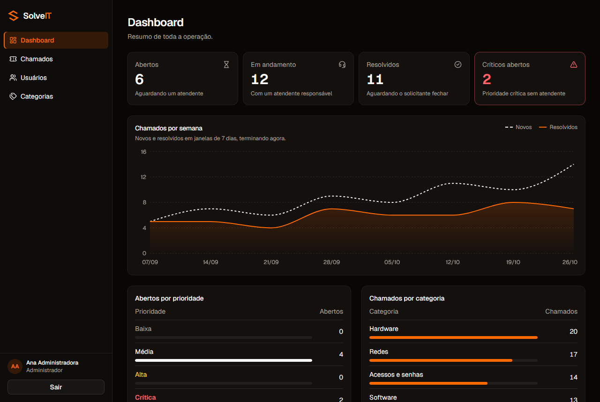
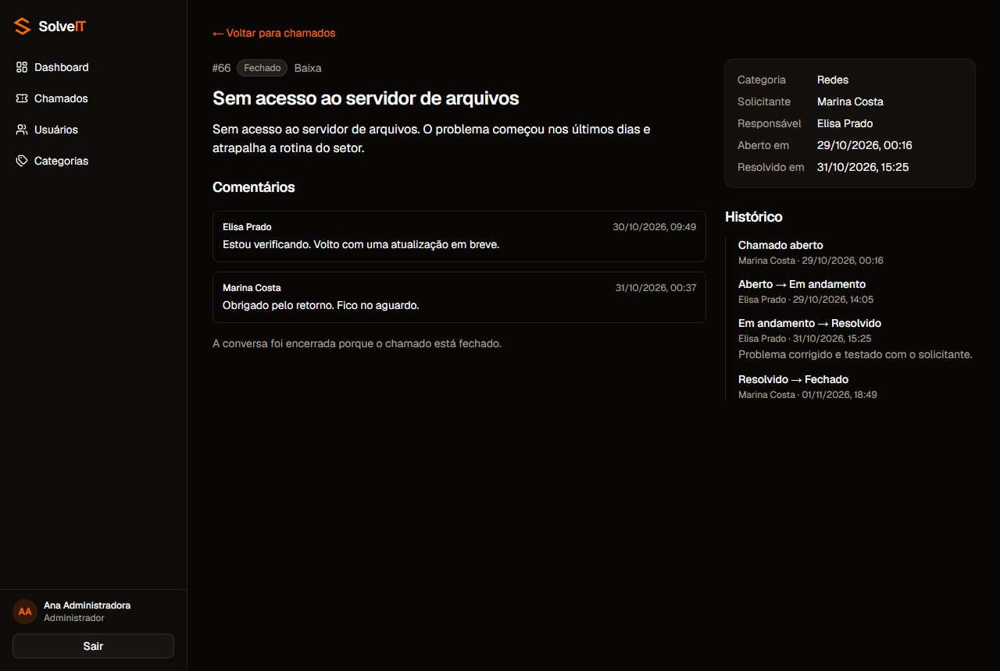
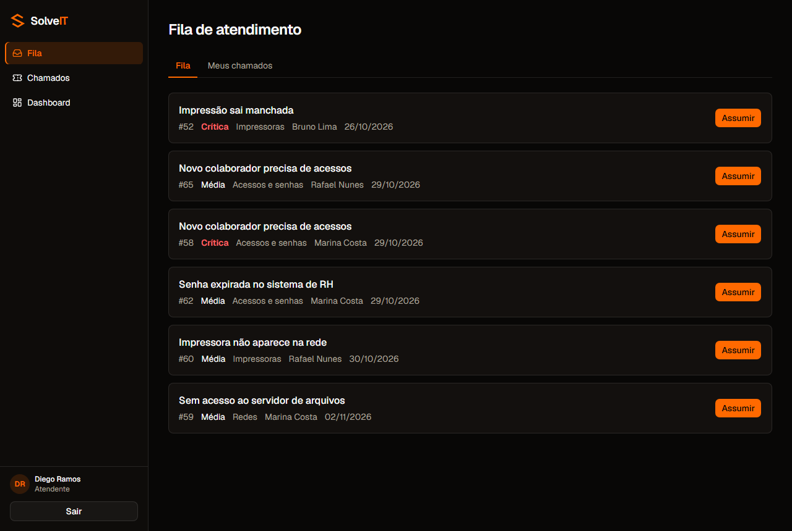
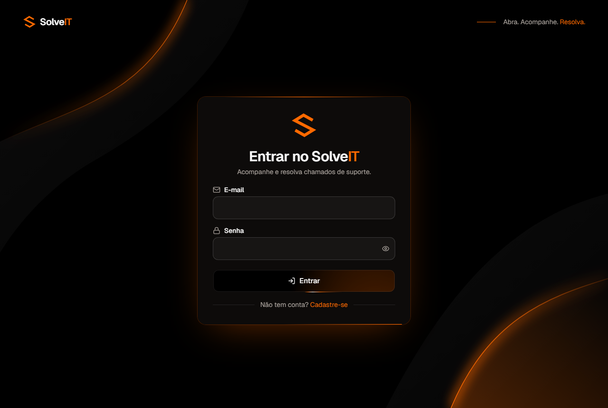
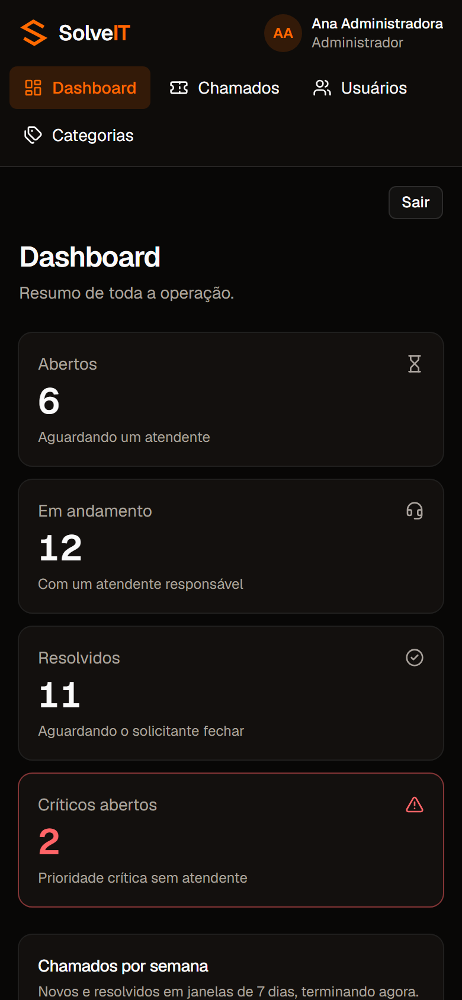
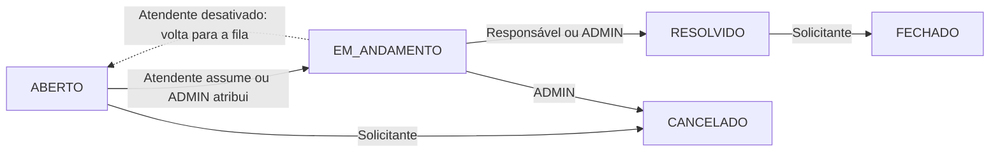
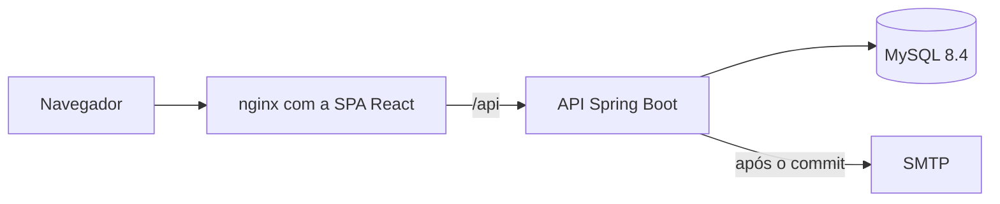

<div align="center">

# SolveIT

### Sistema de chamados de suporte com autorização no servidor, histórico auditável e dashboard

[](https://github.com/Morais-Felipe/SolveIT/actions/workflows/backend-ci.yml)
[](https://github.com/Morais-Felipe/SolveIT/actions/workflows/frontend-ci.yml)
[](https://github.com/Morais-Felipe/SolveIT/actions/workflows/e2e.yml)
[](https://github.com/Morais-Felipe/SolveIT/actions/workflows/demo.yml)

</div>

Solicitantes abrem e acompanham chamados, atendentes conduzem o atendimento e administradores gerenciam a operação. O projeto foi construído para estudar o que uma aplicação de negócio exige por trás das telas: cada permissão é decidida no servidor, cada mudança de status fica registrada e nenhuma disputa entre requisições simultâneas sobrescreve o que já foi confirmado.

## Telas



| Chamado com comentários e histórico | Fila do atendente |
| --- | --- |
|  |  |

| Login | Celular |
| --- | --- |
|  |  |

## Testar em um comando

Requer apenas Docker Desktop. O modo demonstração não precisa de `.env` e já traz chamados distribuídos em 8 semanas:

```bash
docker compose -f docker-compose.demo.yml up --build
```

O primeiro build leva alguns minutos. Depois, abra `http://localhost:8090` e entre com uma das contas, todas com a senha `demo-solveit-2026`:

| Perfil | E-mail |
| --- | --- |
| Administrador | `admin@demo.solveit.test` |
| Atendente | `atendente@demo.solveit.test` |
| Solicitante | `solicitante@demo.solveit.test` |

Os e-mails enviados pelo sistema aparecem em `http://localhost:8026`. Para encerrar e apagar os dados, rode `docker compose -f docker-compose.demo.yml down -v`; uma nova subida renova as datas.

> [!WARNING]
> Essas senhas e os segredos desse arquivo são públicos e valem apenas para este banco local. Não publique o modo demonstração na internet. O [modo normal](docs/DOCUMENTACAO-TECNICA.md#rodar-com-docker-no-modo-normal) não tem nenhuma conta pronta, e um teste E2E garante isso.

## Destaques técnicos

| O que foi resolvido | Como | Onde ver |
| --- | --- | --- |
| **Autorização real, não só visual** | Cada requisição relê do banco o perfil do usuário e a relação dele com o chamado; esconder um botão nunca conta como permissão | [Matriz das 23 rotas](docs/EVIDENCIAS-QUALIDADE.md#qual-03--matriz-de-autorização) |
| **Histórico auditável** | Mudança de status e registro no histórico acontecem na mesma transação; comentários são imutáveis | [`ChamadoTransitionPolicy`](solveit-api/src/main/java/com/solveit/service/ChamadoTransitionPolicy.java) |
| **Disputas entre requisições** | Uma trava no banco serializa escritas, e a versão esperada recusa formulários desatualizados: dois atendentes não assumem o mesmo chamado | [`CoreWriteCoordinator`](solveit-api/src/main/java/com/solveit/service/CoreWriteCoordinator.java) |
| **Banco como fonte de verdade** | Flyway é o único dono do esquema, e o dashboard é calculado no MySQL, sem carregar chamados na memória | [Migrations](solveit-api/src/main/resources/db/migration/) · [`DashboardRepository`](solveit-api/src/main/java/com/solveit/repository/DashboardRepository.java) |
| **E-mail que não atrapalha a operação** | Enviado só depois do commit, fora da requisição; uma falha de SMTP não desfaz nem atrasa o chamado | [Notificações](docs/DOCUMENTACAO-TECNICA.md#notificações-por-e-mail) |
| **Testes contra o banco real** | Testcontainers com MySQL 8.4, em vez de um banco simulado que aceita o que o MySQL recusaria | [Mapa de evidências](docs/EVIDENCIAS-QUALIDADE.md) |

## Como funciona

| Perfil | O que faz |
| --- | --- |
| **Solicitante** | Abre e acompanha os próprios chamados, comenta, cancela enquanto estiver aberto e fecha depois de resolvido |
| **Atendente** | Vê a fila e os chamados atribuídos a si, assume, comenta e resolve |
| **Administrador** | Gerencia usuários e categorias, vê toda a operação, atribui atendentes e acompanha os indicadores |



Qualquer transição fora desse fluxo é recusada, e um teste percorre todas as 150 combinações de origem, destino e ator. Chamados fechados ou cancelados não são reabertos.

## Stack

| Camada | Tecnologias |
| --- | --- |
| Back-end | Java 17, Spring Boot 3, Spring Security, JWT, BCrypt |
| Dados | MySQL 8.4, Spring Data JPA, Flyway |
| Front-end | React 19, TypeScript, Vite, Tailwind CSS v4, shadcn/ui, Recharts |
| Testes | JUnit, MockMvc, Testcontainers, GreenMail, Vitest, Testing Library, Playwright |
| Entrega | Docker Compose, nginx, GitHub Actions |

## Arquitetura



A API é uma aplicação única, organizada em `controller`, `service`, `repository`, `entity`, `dto`, `security`, `exception`, `config` e `enums`. Regras de negócio e autorização ficam em `service`, e os controllers só tratam a fronteira HTTP.

## Testes

| Tipo | Quantidade | O que prova |
| --- | --- | --- |
| Back-end | 248 testes | Regras, permissões, migrations, concorrência e e-mail, com MySQL real |
| Componentes | 90 testes | Telas, validações e estados de carregamento e erro |
| Ponta a ponta | 3 jornadas, em desktop e celular | Os três perfis num navegador real, contra o sistema completo |
| Demonstração | 1 job de CI | O comando deste README continua funcionando |

Tudo roda a cada pull request. O [mapa de evidências](docs/EVIDENCIAS-QUALIDADE.md) aponta qual teste prova cada regra.

## O que aprendi

- **Autorização é uma regra de negócio.** Um perfil não basta: é preciso considerar a relação com o recurso, e no estado atual, não no de quando o token foi emitido.
- **Concorrência aparece em sistemas simples.** Testar transações simultâneas de verdade mostrou problemas que testes sequenciais nunca mostrariam.
- **Migrations versionadas tornam o banco reproduzível.** O mesmo esquema sobe na minha máquina, no CI e em um container novo.
- **Testar contra o banco real compensa o custo.** A suíte demora mais, mas valida o MySQL que a aplicação usa.
- **Um teste que falha também ensina.** Investigar antes de ajustar revelou problemas reais, como um aviso de sucesso que ficava fora da tela no celular.

## Próximos passos

- Rate limiting no login e no cadastro, necessário antes de expor o sistema à internet.
- Demonstração online, para testar sem instalar nada.
- Cache dos dados de lista, para o botão "Voltar" devolver a posição exata na página.

## Documentação

| Documento | Conteúdo |
| --- | --- |
| [Documentação técnica](docs/DOCUMENTACAO-TECNICA.md) | Rodar sem o modo demonstração, regras completas, rotas da API, segurança e limites de escopo |
| [Mapa de evidências](docs/EVIDENCIAS-QUALIDADE.md) | Qual teste prova cada regra e quem pode chamar cada rota |
| [Primeiro administrador](docs/PRIMEIRO-ADMIN.md) | Como criar o primeiro ADMIN no modo normal, sem senha padrão |
| [Notas de estudo](docs/estudos/) | Conceitos e decisões técnicas, para revisar depois |

## Autor

**Felipe Miranda Morais** · [LinkedIn](https://www.linkedin.com/in/morais-felipe/)
