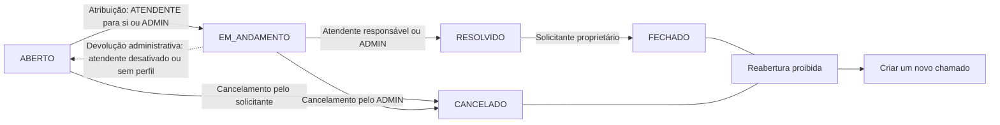

<div align="center">

# SolveIT

### Chamados de suporte com autorização correta, histórico auditável e comunicação clara


[](https://github.com/Morais-Felipe/SolveIT/actions/workflows/backend-ci.yml)
[](https://github.com/Morais-Felipe/SolveIT/actions/workflows/frontend-ci.yml)
[](https://github.com/Morais-Felipe/SolveIT/actions/workflows/e2e.yml)


</div>

> [!IMPORTANT]
> **v1 concluído (Fases 1 a 7).** A API administra usuários e categorias e conduz o chamado por todo o fluxo — abertura, consulta e filtros, edição, atribuição, resolução, fechamento, cancelamento, comentários e histórico auditável —, notifica os envolvidos por e-mail e oferece um dashboard calculado no banco. A SPA React atende os três perfis em desktop e celular. Tudo sobe com um `docker compose`, e cada PR roda 242 testes de back-end contra MySQL 8.4 real, 77 testes de componente e as jornadas de ponta a ponta dos três perfis com Playwright. As evidências estão no [mapa de qualidade](docs/EVIDENCIAS-QUALIDADE.md).

## O que é o SolveIT

O SolveIT é um sistema web para abertura e gerenciamento de chamados de suporte técnico. Solicitantes registram e acompanham problemas, atendentes conduzem o atendimento e administradores gerenciam a operação, os usuários, as categorias e os indicadores.

O projeto nasce como uma aplicação educacional construída do zero. Seu valor central é permitir que um chamado percorra todo o ciclo com autorização validada no servidor, comunicação entre os envolvidos e uma trilha de auditoria que explique cada mudança de status.

As entidades centrais são `Usuario`, `Categoria`, `Chamado`, `Comentario` e `HistoricoStatus`. Os contratos completos estão no [documento de origem](SolveIT_GSD_SystemPrompt.md) e nos [requisitos do v1](.planning/REQUIREMENTS.md).

## Por que o SolveIT

O projeto combina um problema de negócio reconhecível com fundamentos importantes de desenvolvimento web: modelagem relacional, APIs REST, autenticação stateless, autorização contextual, transações, concorrência, migrações, notificações e uma SPA responsiva.

O objetivo não é apenas chegar a uma aplicação funcional. A abordagem **Build to Learn** exige que cada incremento seja pequeno, explicado e verificável, incluindo o motivo das decisões de Spring Boot e os conceitos de banco de dados usados na solução.

## Estado atual

| Item | Situação |
| --- | --- |
| Estado do repositório | Fases 1 a 7 concluídas; CI no GitHub Actions (back-end, front-end e E2E) |
| Fases | 7 de 7 concluídas |
| Requisitos do v1 | 55 de 55 concluídos |
| Aplicação executável | `docker compose up --build` sobe API, web, MySQL e SMTP falso (ver [Rodar tudo com Docker](#rodar-tudo-com-docker)) |
| API disponível | Auth, usuários, categorias, chamados, comentários, histórico e dashboard (ver [Contrato de API](#contrato-de-api)) |
| Telas | Jornadas completas de solicitante, atendente e administrador, em desktop e celular |
| Processo | Planos em `.planning/` executados com Claude Code, um ticket/branch/PR por plano e modo pedagógico |

Tudo o que aparece como implementado neste README está coberto por testes; o [mapa de evidências](docs/EVIDENCIAS-QUALIDADE.md) aponta qual teste prova cada regra.

## Como acompanhar o projeto

- Consulte o [estado atual](.planning/STATE.md) para saber o ponto de continuidade do trabalho.
- Acompanhe a ordem e os critérios de cada incremento no [roadmap](.planning/ROADMAP.md).
- Verifique o escopo e a rastreabilidade nos [requisitos](.planning/REQUIREMENTS.md).
- Veja o que cada plano entregou nos resumos `NN-PP-SUMMARY.md` dentro de [`.planning/phases/`](.planning/phases/).
- Leia o [fluxo Git por ticket](docs/GIT-WORKFLOW.md) antes de iniciar uma mudança.

O andamento só deve ser considerado entregue quando os artefatos de planejamento, os testes proporcionais e o histórico Git confirmarem a conclusão. O texto deste README deve evoluir junto com o estado real do repositório.

## Rodar tudo com Docker

O caminho mais curto para ver o SolveIT funcionando: um comando sobe a API, o front-end, o MySQL 8.4 e o [Mailpit](https://mailpit.axllent.org/) (um SMTP falso com caixa de entrada web). Requer apenas Docker Desktop com o engine Linux; Java e Node não são necessários.

1. Crie o `.env` a partir do modelo e preencha a senha do banco e a chave dos tokens:

   ```powershell
   Copy-Item .env.example .env
   ```

   Para `SOLVEIT_JWT_SECRET`, gere uma chave Base64 com `openssl rand -base64 48` (disponível no Git Bash). O `.env` é ignorado pelo Git; se algum segredo faltar, o compose se recusa a subir e diz qual.

2. Suba os serviços (a primeira vez compila as imagens e leva alguns minutos):

   ```powershell
   docker compose up --build -d
   ```

| Endereço | O que é |
| --- | --- |
| `http://localhost:8080` | Aplicação (o nginx serve o front-end e repassa `/api` para a API) |
| `http://localhost:8025` | Caixa de entrada do Mailpit, com os e-mails enviados pelo SolveIT |

O MySQL e a API não ficam expostos fora da rede interna do compose, e as portas acima só aceitam conexões da própria máquina.

3. Cadastre-se pela aplicação. Para ter o primeiro administrador, siga o procedimento de [primeiro ADMIN](docs/PRIMEIRO-ADMIN.md) dentro do MySQL do compose (a senha pedida é a `DB_PASSWORD` do `.env`):

   ```powershell
   docker compose exec mysql mysql -u solveit -p solveit
   ```

| Comando | O que faz |
| --- | --- |
| `docker compose logs -f api` | Acompanha o log da API (erros 500 aparecem aqui com o mesmo `errorId` da resposta) |
| `docker compose down` | Para tudo e mantém os dados |
| `docker compose down -v` | Para tudo e **apaga** o banco |

## Como verificar o back-end atual

Para compilar e executar os testes no Windows, tenha Java 17 e Docker Desktop com o engine Linux ativo. O Maven Wrapper fixa a versão do Maven do projeto, e o Testcontainers cria bancos MySQL 8.4 temporários para validar persistência, migrações, segurança, regras de negócio e concorrência — `DB_USERNAME` e `DB_PASSWORD` não são necessários nesse caminho.

```powershell
Set-Location solveit-api
.\mvnw.cmd clean verify
```

Em Linux ou macOS, use `./mvnw clean verify`. A suíte atual possui **242 testes** e leva cerca de 15 minutos, porque cada classe de integração sobe seu próprio MySQL. Ela cobre migrações, constraints, JWT, autorização por perfil e relação, filtros e paginação, transições de status, histórico, comentários, notificações por e-mail (com um servidor SMTP em memória, GreenMail) e disputas concorrentes reais entre transações.

A mesma suíte roda automaticamente no **GitHub Actions** ([`backend-ci.yml`](.github/workflows/backend-ci.yml)) a cada pull request e a cada push na `main`, em uma máquina Linux limpa.

> [!NOTE]
> Em algumas máquinas Windows, softwares do próprio host (antivírus, firewall ou VPN) anulam conexões para `localhost`. Nesse caso, os testes de `AuthHttpErrorIntegrationTest` e alguns testes de e-mail podem falhar localmente com `Unable to establish loopback connection` ou "conexão anulada pelo software no computador host". No CI todos os testes passam; a falha é do ambiente, não do código.

Para iniciar a aplicação localmente, crie antes o database `solveit` em uma instância MySQL e forneça as credenciais pelo ambiente. O Flyway cria e versiona as tabelas (V1 a V9), mas deliberadamente não cria o database nem armazena credenciais no repositório.

```powershell
$env:DB_USERNAME = '<usuario-local>'
$env:DB_PASSWORD = '<senha-local>'
Set-Location solveit-api
.\mvnw.cmd spring-boot:run
```

`DB_URL` é opcional e, quando omitida, usa `jdbc:mysql://localhost:3306/solveit` com Unicode e UTC. Para subir tudo junto sem instalar MySQL, use o [`docker-compose`](#rodar-tudo-com-docker).

O cadastro público cria apenas `SOLICITANTE`. Para ter o primeiro administrador em um banco novo, siga o procedimento manual e auditável de [primeiro ADMIN](docs/PRIMEIRO-ADMIN.md); não existe endpoint, *seed* nem senha padrão para isso.

### E-mails em ambiente local

Por padrão a aplicação envia e-mails para um SMTP em `localhost:1025`. Para ver as mensagens sem enviar nada de verdade, suba o [Mailpit](https://mailpit.axllent.org/), que oferece uma caixa de entrada web em `http://localhost:8025`:

```powershell
docker run -d --name solveit-mailpit -p 1025:1025 -p 8025:8025 axllent/mailpit
```

| Variável | Padrão | Uso |
| --- | --- | --- |
| `SOLVEIT_MAIL_HOST` | `localhost` | Servidor SMTP |
| `SOLVEIT_MAIL_PORT` | `1025` | Porta SMTP |
| `SOLVEIT_MAIL_FROM` | `solveit@localhost` | Remetente |
| `SOLVEIT_MAIL_ENABLED` | `true` | `false` desliga os envios sem afetar a API |

Sem nenhum SMTP disponível a API continua funcionando normalmente: a falha de envio fica apenas no log. No [`docker-compose`](#rodar-tudo-com-docker) o Mailpit já vem incluído.

## Como rodar o front-end

O front-end fica em [`solveit-web/`](solveit-web/): React 19 + TypeScript, Vite, Tailwind CSS v4 e componentes [shadcn/ui](https://ui.shadcn.com/). Requer Node.js 22.12 ou superior.

```powershell
Set-Location solveit-web
npm install
npm run dev
```

Abra `http://localhost:5173`. Em desenvolvimento, o Vite repassa as chamadas `/api/*` para a API em `http://localhost:8080` (ajustável com `SOLVEIT_API_URL`), então a API precisa estar rodando para entrar no sistema. Sem ela, a tela de login mostra "O servidor não respondeu".

| Comando | O que faz |
| --- | --- |
| `npm run dev` | Servidor de desenvolvimento com recarga automática |
| `npm test` | Testes de componente (Vitest + Testing Library) |
| `npm run typecheck` | Checagem de tipos do TypeScript |
| `npm run lint` | Lint (oxlint) |
| `npm run build` | Build de produção em `solveit-web/dist` |

O token de acesso fica no `localStorage` para manter a sessão ao recarregar a página; ao abrir o app ele é validado com `GET /api/auth/me` e descartado se a API recusar. O GitHub Actions ([`frontend-ci.yml`](.github/workflows/frontend-ci.yml)) executa lint, tipos, testes e build a cada PR.

### Testes de ponta a ponta (Playwright)

As jornadas dos três perfis rodam num navegador real contra o sistema completo do `docker compose`, em desktop (1280 px) e celular (360 px). Requer Docker Desktop em execução; na primeira vez, baixe o navegador:

```powershell
Set-Location solveit-web
npx playwright install chromium
npm run e2e
```

O comando sobe um compose **separado** do de desenvolvimento (projeto `solveit-e2e`, portas 8180 e 8125), cria o primeiro ADMIN com o SQL de [`docs/PRIMEIRO-ADMIN.md`](docs/PRIMEIRO-ADMIN.md), percorre as jornadas e apaga containers e volume no fim. Seus dados do compose `solveit` não são tocados. Se algo falhar, `npx playwright show-report` abre o relatório com o rastro (trace) de cada passo. O workflow [`e2e.yml`](.github/workflows/e2e.yml) faz o mesmo a cada PR.

## Como funciona

Um `SOLICITANTE` abre um chamado em uma categoria ativa. O chamado nasce `ABERTO`, sem atendente, e no mesmo instante ganha seu primeiro `HistoricoStatus` (`null → ABERTO`). Um atendente assume o chamado da fila — ou um administrador o atribui — e ele passa a `EM_ANDAMENTO`. O responsável resolve, registrando `resolvidoEm`, e o solicitante encerra o ciclo ao fechar.

Durante o processo, pessoas autorizadas consultam o detalhe, comentam e acompanham o histórico. A API decide o acesso usando simultaneamente o perfil **atual** do usuário e sua relação **atual** com o chamado, relidos do banco a cada requisição; esconder um botão no front-end nunca é tratado como autorização.

Toda escrita relevante passa por uma trava global no banco (`core_write_guard`), que serializa decisões concorrentes. Cada transição válida atualiza o chamado e cria exatamente um `HistoricoStatus` na mesma transação, e formulários desatualizados são recusados pela versão esperada (`versaoEsperada`).

## Perfis e responsabilidades

| Perfil | Pode fazer hoje | Limites principais |
| --- | --- | --- |
| `SOLICITANTE` | Cadastrar-se, abrir e acompanhar os próprios chamados, editar título/descrição enquanto `ABERTO`, comentar, cancelar um chamado `ABERTO` e fechar um chamado `RESOLVIDO` | Não administra usuários ou categorias; não vê chamados alheios |
| `ATENDENTE` | Ver a fila (`ABERTO` sem responsável) e os chamados atribuídos a si, assumir chamados, comentar e resolver os que são seus | Só assume para si mesmo; não fecha nem cancela; perde o acesso quando o chamado passa a outro atendente |
| `ADMIN` | Administrar usuários e categorias, ver todos os chamados, atribuir atendentes, resolver e cancelar chamados `EM_ANDAMENTO`, editar chamados `ABERTO` | Não fecha chamados nem cancela chamados `ABERTO` (decisões do solicitante); continua sujeito ao fluxo de status e à auditoria |

O cadastro público cria exclusivamente usuários `SOLICITANTE`. Contas `ATENDENTE` e `ADMIN` são criadas por um administrador. Ativar/desativar usuários e trocar perfis acontece numa única operação administrativa, que devolve à fila os chamados em andamento de um atendente desativado.

## Regras críticas

Todas as regras abaixo estão implementadas e provadas por testes de integração, salvo indicação.

- Apenas solicitantes abrem chamados; todo chamado nasce `ABERTO`, sem atendente, com histórico inicial.
- A atribuição de um atendente muda o status automaticamente para `EM_ANDAMENTO`; a primeira atribuição confirmada vence.
- Apenas o atendente responsável ou um administrador pode mover `EM_ANDAMENTO` para `RESOLVIDO`.
- Apenas o solicitante proprietário pode mover `RESOLVIDO` para `FECHADO`.
- O solicitante proprietário pode cancelar um chamado `ABERTO`; somente um administrador pode cancelar um chamado `EM_ANDAMENTO`.
- Título e descrição só podem ser editados enquanto o chamado está `ABERTO`, pelo solicitante proprietário ou por um administrador.
- Chamados `FECHADO` ou `CANCELADO` não podem ser reabertos; um novo chamado deve ser criado.
- Comentários são imutáveis: não existe rota para editar ou excluir comentário, e comentar não reserva o chamado.
- Toda mudança de status cria exatamente um `HistoricoStatus`, atomicamente com a alteração do chamado; tentativas recusadas não geram histórico.
- Atualizações concorrentes não sobrescrevem silenciosamente uma transição já confirmada.
- `EM_ANDAMENTO → ABERTO` só acontece por devolução administrativa auditada, ao desativar ou retirar o perfil de um atendente.
- O sistema nunca fica sem um `ADMIN` ativo, inclusive sob operações simultâneas.

## Fluxo de status



Qualquer transição que não apareça no diagrama é rejeitada com `409 INVALID_STATE`; um ator sem permissão para a transição recebe `403`. A tabela de transições vive em `ChamadoTransitionPolicy` e é verificada por um teste que percorre todas as 150 combinações de origem, destino e ator.

### Notificações por e-mail

| Evento confirmado | Destinatários |
| --- | --- |
| Novo chamado `ABERTO` | Administradores ativos |
| Novo chamado `CRITICA` | Administradores ativos, com `[URGENTE]` no assunto |
| Atendente atribuído | Atendente e solicitante |
| Status atualizado (inclui devolução à fila) | Solicitante |
| Novo comentário | Solicitante e atendente atual, sem duplicatas |

Quem executa a ação não recebe e-mail dela, e usuários inativos nunca recebem. Os serviços publicam um evento dentro da transação; um listener com `@TransactionalEventListener(AFTER_COMMIT)` e `@Async` só envia depois que ela é confirmada, fora da thread da requisição. Uma transação desfeita não envia nada, e uma falha de SMTP é apenas registrada em log, sem desfazer nem atrasar a operação. Cada destinatário recebe uma mensagem própria, sem ver os demais endereços.

### Dashboard

`GET /api/dashboard/resumo` (ADMIN e ATENDENTE) responde com quatro indicadores, todos calculados no MySQL com `COUNT` e `GROUP BY`, sem carregar os chamados na aplicação:

| Indicador | Significado |
| --- | --- |
| Totais | Chamados `ABERTO`, `EM_ANDAMENTO` e `RESOLVIDO`, e críticos ainda `ABERTO` (aguardando alguém assumir) |
| Por categoria | Todos os chamados visíveis, de qualquer status, por categoria (inclui categorias desativadas) |
| Carga por atendente | Chamados `EM_ANDAMENTO` de cada atendente responsável |
| Abertos por prioridade | Chamados `ABERTO` por prioridade, sempre com as quatro prioridades |

Os números usam a mesma regra de visibilidade da lista de chamados: o ADMIN vê toda a operação e o ATENDENTE vê a fila e os chamados atribuídos a ele. Por isso cada indicador é igual ao total de `GET /api/chamados` com o filtro equivalente, o que os testes verificam.

## Stack do projeto

| Camada | Tecnologias | Situação |
| --- | --- | --- |
| Back-end | Java 17, Spring Boot 3, Spring MVC | Implementado |
| Persistência | MySQL 8.4, Spring Data JPA, Hibernate, Specifications | Implementado |
| Migrações | Flyway (V1 a V9) | Implementado; único responsável pelo esquema |
| Segurança | Spring Security, JWT (JJWT), BCrypt | Implementado |
| Testes | JUnit, AssertJ, MockMvc, Testcontainers MySQL, GreenMail | Implementado (242 testes) |
| CI | GitHub Actions | Implementado — back-end, front-end e E2E a cada PR |
| Notificações | JavaMailSender via SMTP, eventos após commit, `@Async` | Implementado |
| Front-end | React 19, TypeScript, Vite, Tailwind CSS v4, shadcn/ui, React Router, Axios | Implementado |
| Testes de interface | Vitest e React Testing Library (77 testes); Playwright para as jornadas E2E | Implementado |
| Entrega | Docker Compose (API, nginx, MySQL, Mailpit) | Implementado |

Segredos de banco, JWT e SMTP vêm do ambiente ou de um cofre de segredos; não são versionados em arquivos de configuração.

## Arquitetura do projeto

O back-end é uma aplicação modular única em Spring Boot. A separação por responsabilidade mantém regras de negócio nos services, contratos HTTP nos controllers e persistência nos repositories:

```text
solveit-api/
└── src/main/java/com/solveit/
    ├── config/
    ├── controller/
    ├── dto/
    ├── entity/
    ├── enums/
    ├── exception/
    ├── repository/
    ├── security/
    └── service/
```

- `config`: configuração de segurança, JWT e relógio UTC.
- `controller`: endpoints REST finos e validação da fronteira HTTP.
- `dto`: requests e responses em `record`s; requests rejeitam campos fora do contrato em vez de ignorá-los.
- `entity` e `enums`: modelo persistente e vocabulário do domínio; `Comentario` e `HistoricoStatus` não têm setters.
- `exception`: erros no formato Problem Details (RFC 9457), sem stack traces ou segredos.
- `repository`: consultas JPA, `Specification`s de visibilidade e filtros, paginação e ordenação no banco.
- `security`: filtro JWT, identidade autenticada e handlers de 401/403.
- `service`: transações, coordenação de escritas (`CoreWriteCoordinator`), política de leitura (`ChamadoAuthorizationService`), tabela de transições (`ChamadoTransitionPolicy`) e demais invariantes.

O front-end é uma SPA React separada, que consome a API por uma instância Axios centralizada. As telas incluem login e cadastro, lista e abertura de chamados do solicitante, detalhe com comentários e histórico, fila do atendente, dashboard administrativo e administração de usuários e categorias.

## Contrato de API

Todas as rotas abaixo estão implementadas e testadas (✅); a matriz de quem pode chamar cada uma está no [mapa de evidências](docs/EVIDENCIAS-QUALIDADE.md#qual-03--matriz-de-autorização).

| Grupo | Método e rota | Acesso e finalidade | Estado |
| --- | --- | --- | --- |
| Auth | `POST /api/auth/register` | Público; cria apenas `SOLICITANTE` | ✅ |
| Auth | `POST /api/auth/login` | Público; autentica e retorna JWT limitado no tempo | ✅ |
| Auth | `GET /api/auth/me` | Autenticado; retorna os próprios dados | ✅ |
| Usuários | `GET /api/usuarios` · `GET /api/usuarios/{id}` | `ADMIN`; lista paginada e consulta por id | ✅ |
| Usuários | `POST /api/usuarios` | `ADMIN`; cria qualquer perfil, sempre ativo | ✅ |
| Usuários | `PUT /api/usuarios/{id}` | `ADMIN`; edita nome, e-mail e senha com versão esperada | ✅ |
| Usuários | `PATCH /api/usuarios/{id}/operacao` | `ADMIN`; muda perfil e atividade numa operação atômica, devolve à fila os chamados em andamento do atendente e protege o último ADMIN | ✅ |
| Categorias | `GET /api/categorias` · `GET /api/categorias/{id}` | Autenticado; ativas para todos; inativa por id para ADMIN ou quem vê chamado vinculado | ✅ |
| Categorias | `POST /api/categorias` · `PUT /api/categorias/{id}` | `ADMIN`; nome único, edição com versão esperada | ✅ |
| Categorias | `PATCH /api/categorias/{id}/ativo` | `ADMIN`; ativa ou desativa sem excluir | ✅ |
| Chamados | `GET /api/chamados` | Autenticado; página no escopo do perfil, filtros por status, prioridade, categoria, atendente e solicitante | ✅ |
| Chamados | `GET /api/chamados/{id}` | Autorizado por perfil e relação atual; detalhe completo | ✅ |
| Chamados | `POST /api/chamados` | `SOLICITANTE`; abre chamado com histórico inicial | ✅ |
| Chamados | `PUT /api/chamados/{id}` | Solicitante proprietário ou `ADMIN`; título e descrição somente em `ABERTO` | ✅ |
| Chamados | `PATCH /api/chamados/{id}/atendente` | `ATENDENTE` para si ou `ADMIN`; atribui e inicia atendimento | ✅ |
| Chamados | `PATCH /api/chamados/{id}/status` | Ator autorizado; resolver, fechar ou cancelar | ✅ |
| Comentários | `GET /api/chamados/{id}/comentarios` | Usuário com acesso; ordem cronológica | ✅ |
| Comentários | `POST /api/chamados/{id}/comentarios` | Usuário com acesso; comentário imutável | ✅ |
| Histórico | `GET /api/chamados/{id}/historico` | Usuário com acesso; trilha cronológica completa | ✅ |
| Dashboard | `GET /api/dashboard/resumo` | `ADMIN` e `ATENDENTE`; totais por status e críticos abertos, chamados por categoria, carga ativa por atendente e abertos por prioridade, no escopo do perfil | ✅ |

Comandos que alteram recursos versionados exigem `versaoEsperada` e respondem `409 STALE_RESOURCE` quando o recurso mudou. Erros seguem Problem Details com um `code` estável (`VALIDATION_ERROR`, `ACCESS_DENIED`, `INVALID_STATE`, `COMMENTS_CLOSED`, `CORE_BUSY`, entre outros). Respostas nunca expõem senhas, entidades JPA, segredos ou stack traces, e listagens são calculadas no banco.

## Roadmap

As sete fases são incrementos sequenciais.

| Fase | Entrega | Estado |
| --- | --- | --- |
| 1 — Base do Projeto | Aplicação Spring inicial sobre esquema MySQL completo, versionado por Flyway e validado pelo JPA | Concluída — 5/5 planos |
| 2 — Autenticação | Cadastro de solicitante, login JWT e autorização por perfil e relação | Concluída — 8/8 planos |
| 3 — Core de Chamados | Administração, ciclo completo do chamado, comentários e histórico auditável | Concluída — 10/10 planos |
| 4 — Notificações por E-mail | Comunicação dos eventos confirmados aos envolvidos corretos | Concluída — 1/1 plano |
| 5 — Dashboard | Indicadores autorizados para administradores e atendentes | Concluída — 1/1 plano |
| 6 — Front-end (React + Tailwind) | Jornadas principais dos três perfis na SPA responsiva | Concluída — 5/5 planos |
| 7 — Polimento e Qualidade | Erros seguros, docker compose, E2E, responsividade e mapa de evidências | Concluída — 2/2 planos |

### Entregas da Fase 3

| Plano | Entrega | PR |
| --- | --- | --- |
| 03-01 | Catálogo de categorias e coordenação das escritas | [#13](https://github.com/Morais-Felipe/SolveIT/pull/13) |
| 03-02 | Edição e ativação/desativação de categorias | [#14](https://github.com/Morais-Felipe/SolveIT/pull/14) |
| 03-03 | Gestão de usuários pelo ADMIN | [#15](https://github.com/Morais-Felipe/SolveIT/pull/15) |
| 03-04 | Abertura de chamado com histórico atômico | [#16](https://github.com/Morais-Felipe/SolveIT/pull/16) |
| 03-05 | Consulta, filtros e edição no escopo correto | [#17](https://github.com/Morais-Felipe/SolveIT/pull/17) |
| 03-06 | Atribuição com um único vencedor | [#18](https://github.com/Morais-Felipe/SolveIT/pull/18) |
| 03-07 | Resolver, fechar e cancelar | [#19](https://github.com/Morais-Felipe/SolveIT/pull/19) |
| 03-08 | Comentários com acesso atual e concorrência segura | [#20](https://github.com/Morais-Felipe/SolveIT/pull/20) |
| 03-09 | Leitura de comentários e histórico; imutabilidade | [#21](https://github.com/Morais-Felipe/SolveIT/pull/21) |
| 03-10 | Ativação/perfil de usuários, devolução auditada e último ADMIN (sem prévia, após revisão de escopo) | Ticket 22 |

Metas, dependências, critérios de sucesso e rastreabilidade estão no [roadmap completo](.planning/ROADMAP.md); cada plano tem seu `PLAN` e `SUMMARY` em `.planning/phases/`.

### Pendências técnicas conhecidas

- Rate limiting de login e cadastro antes de qualquer exposição à internet.
- `npm audit` aponta vulnerabilidades moderadas na cadeia da CLI do shadcn (`ts-morph` → `minimatch`), ferramenta de geração de componentes que não entra no build; a correção sugerida exige rebaixar o shadcn e ficou para avaliação.

## Referência visual


A direção visual aprovada, seguida pela Fase 6, usa tema escuro, destaque laranja, navegação lateral, cards, tabelas densas, indicadores, gráficos e chips semânticos. A imagem é uma referência de composição desktop: seus textos e dados são ilustrativos e não criam novos requisitos, estados, telas ou relatórios.

Consulte o [contrato da referência visual](docs/design/SOLVEIT-UI-REFERENCE.md) para a tradução dos elementos ao domínio e seus limites.

## Fluxo Git por ticket

Cada plano de implementação usa um ticket com branch própria (`ticket/NN-descricao-curta`), depois de planejamento e aprovação antes da escrita de código. Durante o trabalho, mudanças verificáveis recebem commits atômicos no padrão Conventional Commits.

Após testes e resumo, push, pull request e merge acontecem com **uma** autorização explícita do responsável para aquele ticket (decisão de 2026-10-30), e o merge só depois do CI verde. O procedimento completo está em [Fluxo Git por ticket](docs/GIT-WORKFLOW.md).

## Segurança e auditoria

- Senhas são armazenadas apenas como hash BCrypt e não aparecem em respostas ou logs.
- JWTs são temporários e carregam só a identidade; perfil e atividade são relidos do banco a cada requisição.
- Toda operação protegida verifica perfil e relação **atuais** com o recurso no servidor; autoria antiga de comentário não concede acesso.
- O cadastro público não cria `ATENDENTE` nem `ADMIN`; o primeiro ADMIN segue um [procedimento manual auditável](docs/PRIMEIRO-ADMIN.md).
- Categorias e usuários são desativados sem exclusão; o último ADMIN ativo é protegido.
- Mudança de status e criação do respectivo histórico ocorrem na mesma transação; uma falha no histórico desfaz a mudança.
- Escritas concorrentes são serializadas por uma trava no banco e por versão esperada, provadas com transações MySQL reais.
- Comentários são imutáveis e atribuídos à identidade autenticada.
- Requests rejeitam campos fora do contrato (como `autorId`, `status` ou datas) em vez de ignorá-los silenciosamente.
- Erros são normalizados sem vazar stack traces, entidades persistentes, credenciais ou detalhes internos.
- Testes negativos cobrem acesso sem token, perfil incorreto, recurso de outro usuário, transições proibidas e disputas concorrentes.

## Objetivos de aprendizagem

- Construir uma aplicação Spring Boot 3 em Java 17 com separação clara de responsabilidades.
- Modelar relações, chaves estrangeiras, restrições, índices e consultas paginadas em MySQL 8.
- Usar Flyway como fonte única e reproduzível do esquema, com JPA em modo de validação.
- Entender autenticação JWT, hash BCrypt e autorização além das restrições visuais.
- Projetar transações e locks que preservem invariantes e trilhas de auditoria sob concorrência.
- Integrar e-mail com comportamento de falha explícito e testar fronteiras externas.
- Criar uma SPA React responsiva orientada às jornadas de cada perfil.
- Evoluir em incrementos pequenos, explicados, testados e revisáveis.

## Limites de escopo

O v1 é limitado às entidades, rotas, regras, telas e indicadores registrados nos contratos atuais. Permanecem fora do escopo:

- anexos, base de conhecimento e entrada omnichannel;
- SLA avançado, escalonamento, CMDB e automação genérica;
- CSAT ou pesquisa de satisfação;
- exportação de listas ou relatórios;
- aplicativo móvel nativo;
- inteligência artificial;
- microserviços e broker de mensagens;
- fluxos de status configuráveis;
- edição ou exclusão de comentários;
- cadastro público de atendentes ou administradores;
- reabertura de chamados `FECHADO` ou `CANCELADO`.

Qualquer ampliação depende de uma decisão futura explícita e de atualização dos requisitos.

## Documentação

| Documento | Conteúdo |
| --- | --- |
| [Visão e decisões do projeto](.planning/PROJECT.md) | Valor central, contexto, restrições e decisões |
| [Requisitos e rastreabilidade](.planning/REQUIREMENTS.md) | Escopo v1, itens futuros e exclusões |
| [Roadmap](.planning/ROADMAP.md) | Sete fases, metas, dependências e critérios de sucesso |
| [Estado atual](.planning/STATE.md) | Posição, progresso, decisões e pontos de atenção |
| [Planos e resumos](.planning/phases/) | Planos, decisões aprovadas e evidências de cada entrega, por fase |
| [Evidências de qualidade](docs/EVIDENCIAS-QUALIDADE.md) | Qual teste prova cada regra; matriz de autorização das 23 rotas |
| [Notas de estudo](docs/estudos/) | Conceitos e decisões de cada plano, para revisar depois |
| [Contrato original do SolveIT](SolveIT_GSD_SystemPrompt.md) | Domínio, entidades, regras, rotas e ordem inicial |
| [Primeiro ADMIN](docs/PRIMEIRO-ADMIN.md) | Procedimento manual e auditável para o primeiro administrador |
| [Referência visual](docs/design/SOLVEIT-UI-REFERENCE.md) | Direção visual e limites da composição |
| [Imagem da referência visual](docs/design/solveit-ui-reference.png) | Composição versionada para consulta |
| [Fluxo Git por ticket](docs/GIT-WORKFLOW.md) | Branches, commits, validação, push e integração |

---

<div align="center">

**SolveIT — construir para aprender, sem perder segurança, rastreabilidade e clareza.**

</div>
