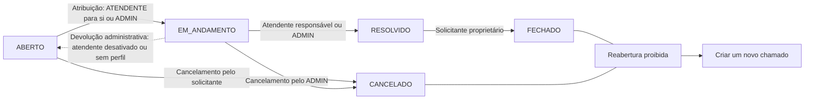

# Documentação técnica do SolveIT

Detalhes para quem quer rodar, estudar ou modificar o projeto. A visão geral está no [README](../README.md).

## Rodar com Docker no modo normal

Para só experimentar, o [modo demonstração](../README.md#testar-com-docker) é mais simples. Este é o modo normal, sem nenhuma conta pronta: um comando sobe a API, o front-end, o MySQL 8.4 e o [Mailpit](https://mailpit.axllent.org/) (um SMTP falso com caixa de entrada web). Requer apenas Docker Desktop com o engine Linux; Java e Node não são necessários.

1. Crie o `.env` a partir do modelo e preencha a senha do banco e a chave dos tokens:

   ```powershell
   Copy-Item .env.example .env
   ```

   Para `SOLVEIT_JWT_SECRET`, gere uma chave Base64 com `openssl rand -base64 48` (disponível no Git Bash). O `.env` é ignorado pelo Git; se algum segredo faltar, o compose se recusa a subir e diz qual.

2. Suba os serviços (a primeira vez compila as imagens e leva alguns minutos):

   ```powershell
   docker compose up --build -d
   ```

| Endereço | O que é |
| --- | --- |
| `http://localhost:8080` | Aplicação (o nginx serve o front-end e repassa `/api` para a API) |
| `http://localhost:8025` | Caixa de entrada do Mailpit, com os e-mails enviados pelo SolveIT |

O MySQL e a API não ficam expostos fora da rede interna do compose, e as portas acima só aceitam conexões da própria máquina.

3. Cadastre-se pela aplicação. Para ter o primeiro administrador, siga o procedimento de [primeiro ADMIN](PRIMEIRO-ADMIN.md) dentro do MySQL do compose (a senha pedida é a `DB_PASSWORD` do `.env`):

   ```powershell
   docker compose exec mysql mysql -u solveit -p solveit
   ```

| Comando | O que faz |
| --- | --- |
| `docker compose logs -f api` | Acompanha o log da API (erros 500 aparecem aqui com o mesmo `errorId` da resposta) |
| `docker compose down` | Para tudo e mantém os dados |
| `docker compose down -v` | Para tudo e **apaga** o banco |

## Rodar e testar o back-end

Para compilar e executar os testes no Windows, tenha Java 17 e Docker Desktop com o engine Linux ativo. O Maven Wrapper fixa a versão do Maven do projeto, e o Testcontainers cria bancos MySQL 8.4 temporários para validar persistência, migrações, segurança, regras de negócio e concorrência — `DB_USERNAME` e `DB_PASSWORD` não são necessários nesse caminho.

```powershell
Set-Location solveit-api
.\mvnw.cmd clean verify
```

Em Linux ou macOS, use `./mvnw clean verify`. A suíte atual possui **248 testes** e leva cerca de 15 minutos, porque cada classe de integração sobe seu próprio MySQL. Ela cobre migrações, constraints, JWT, autorização por perfil e relação, filtros e paginação, transições de status, histórico, comentários, notificações por e-mail (com um servidor SMTP em memória, GreenMail) e disputas concorrentes reais entre transações.

A mesma suíte roda automaticamente no **GitHub Actions** ([`backend-ci.yml`](../.github/workflows/backend-ci.yml)) a cada pull request e a cada push na `main`, em uma máquina Linux limpa.

> [!NOTE]
> Em algumas máquinas Windows, softwares do próprio host (antivírus, firewall ou VPN) anulam conexões para `localhost`. Nesse caso, os testes de `AuthHttpErrorIntegrationTest` e alguns testes de e-mail podem falhar localmente com `Unable to establish loopback connection` ou "conexão anulada pelo software no computador host". No CI todos os testes passam; a falha é do ambiente, não do código.

Para iniciar a aplicação localmente, crie antes o database `solveit` em uma instância MySQL e forneça as credenciais pelo ambiente. O Flyway cria e versiona as tabelas (V1 a V9), mas deliberadamente não cria o database nem armazena credenciais no repositório.

```powershell
$env:DB_USERNAME = '<usuario-local>'
$env:DB_PASSWORD = '<senha-local>'
Set-Location solveit-api
.\mvnw.cmd spring-boot:run
```

`DB_URL` é opcional e, quando omitida, usa `jdbc:mysql://localhost:3306/solveit` com Unicode e UTC. Para subir tudo junto sem instalar MySQL, use o [`docker-compose`](#rodar-com-docker-no-modo-normal).

O cadastro público cria apenas `SOLICITANTE`. Para ter o primeiro administrador em um banco novo, siga o procedimento manual e auditável de [primeiro ADMIN](PRIMEIRO-ADMIN.md); não existe endpoint, *seed* nem senha padrão para isso.

### E-mails em ambiente local

Por padrão a aplicação envia e-mails para um SMTP em `localhost:1025`. Para ver as mensagens sem enviar nada de verdade, suba o [Mailpit](https://mailpit.axllent.org/), que oferece uma caixa de entrada web em `http://localhost:8025`:

```powershell
docker run -d --name solveit-mailpit -p 1025:1025 -p 8025:8025 axllent/mailpit
```

| Variável | Padrão | Uso |
| --- | --- | --- |
| `SOLVEIT_MAIL_HOST` | `localhost` | Servidor SMTP |
| `SOLVEIT_MAIL_PORT` | `1025` | Porta SMTP |
| `SOLVEIT_MAIL_FROM` | `solveit@localhost` | Remetente |
| `SOLVEIT_MAIL_ENABLED` | `true` | `false` desliga os envios sem afetar a API |

Sem nenhum SMTP disponível a API continua funcionando normalmente: a falha de envio fica apenas no log. No [`docker-compose`](#rodar-com-docker-no-modo-normal) o Mailpit já vem incluído.

## Rodar e testar o front-end

O front-end fica em [`solveit-web/`](../solveit-web/): React 19 + TypeScript, Vite, Tailwind CSS v4 e componentes [shadcn/ui](https://ui.shadcn.com/). Requer Node.js 22.12 ou superior.

```powershell
Set-Location solveit-web
npm install
npm run dev
```

Abra `http://localhost:5173`. Em desenvolvimento, o Vite repassa as chamadas `/api/*` para a API em `http://localhost:8080` (ajustável com `SOLVEIT_API_URL`), então a API precisa estar rodando para entrar no sistema. Sem ela, a tela de login mostra "O servidor não respondeu".

| Comando | O que faz |
| --- | --- |
| `npm run dev` | Servidor de desenvolvimento com recarga automática |
| `npm test` | Testes de componente (Vitest + Testing Library) |
| `npm run typecheck` | Checagem de tipos do TypeScript |
| `npm run lint` | Lint (oxlint) |
| `npm run build` | Build de produção em `solveit-web/dist` |

O token de acesso fica no `localStorage` para manter a sessão ao recarregar a página; ao abrir o app ele é validado com `GET /api/auth/me` e descartado se a API recusar. O GitHub Actions ([`frontend-ci.yml`](../.github/workflows/frontend-ci.yml)) executa lint, tipos, testes e build a cada PR.

### Testes de ponta a ponta (Playwright)

As jornadas dos três perfis rodam num navegador real contra o sistema completo do `docker compose`, em desktop (1280 px) e celular (360 px). Requer Docker Desktop em execução; na primeira vez, baixe o navegador:

```powershell
Set-Location solveit-web
npx playwright install chromium
npm run e2e
```

O comando sobe um compose **separado** do de desenvolvimento (projeto `solveit-e2e`, portas 8180 e 8125), cria o primeiro ADMIN com o SQL de [`PRIMEIRO-ADMIN.md`](PRIMEIRO-ADMIN.md), percorre as jornadas e apaga containers e volume no fim. Seus dados do compose `solveit` não são tocados. Se algo falhar, `npx playwright show-report` abre o relatório com o rastro (trace) de cada passo. O workflow [`e2e.yml`](../.github/workflows/e2e.yml) faz o mesmo a cada PR.

## Ciclo de um chamado

Um `SOLICITANTE` abre um chamado em uma categoria ativa. O chamado nasce `ABERTO`, sem atendente, e no mesmo instante ganha seu primeiro `HistoricoStatus` (`null → ABERTO`). Um atendente assume o chamado da fila — ou um administrador o atribui — e ele passa a `EM_ANDAMENTO`. O responsável resolve, registrando `resolvidoEm`, e o solicitante encerra o ciclo ao fechar.

Durante o processo, pessoas autorizadas consultam o detalhe, comentam e acompanham o histórico. A API decide o acesso usando simultaneamente o perfil **atual** do usuário e sua relação **atual** com o chamado, relidos do banco a cada requisição; esconder um botão no front-end nunca é tratado como autorização.

Toda escrita relevante passa por uma trava global no banco (`core_write_guard`), que serializa decisões concorrentes. Cada transição válida atualiza o chamado e cria exatamente um `HistoricoStatus` na mesma transação, e formulários desatualizados são recusados pela versão esperada (`versaoEsperada`).

## Perfis e responsabilidades

| Perfil | Pode fazer hoje | Limites principais |
| --- | --- | --- |
| `SOLICITANTE` | Cadastrar-se, abrir e acompanhar os próprios chamados, editar título/descrição enquanto `ABERTO`, comentar, cancelar um chamado `ABERTO` e fechar um chamado `RESOLVIDO` | Não administra usuários ou categorias; não vê chamados alheios |
| `ATENDENTE` | Ver a fila (`ABERTO` sem responsável) e os chamados atribuídos a si, assumir chamados, comentar e resolver os que são seus | Só assume para si mesmo; não fecha nem cancela; perde o acesso quando o chamado passa a outro atendente |
| `ADMIN` | Administrar usuários e categorias, ver todos os chamados, atribuir atendentes, resolver e cancelar chamados `EM_ANDAMENTO`, editar chamados `ABERTO` | Não fecha chamados nem cancela chamados `ABERTO` (decisões do solicitante); continua sujeito ao fluxo de status e à auditoria |

O cadastro público cria exclusivamente usuários `SOLICITANTE`. Contas `ATENDENTE` e `ADMIN` são criadas por um administrador. Ativar/desativar usuários e trocar perfis acontece numa única operação administrativa, que devolve à fila os chamados em andamento de um atendente desativado.

## Regras críticas

Todas as regras abaixo estão implementadas e provadas por testes de integração, salvo indicação.

- Apenas solicitantes abrem chamados; todo chamado nasce `ABERTO`, sem atendente, com histórico inicial.
- A atribuição de um atendente muda o status automaticamente para `EM_ANDAMENTO`; a primeira atribuição confirmada vence.
- Apenas o atendente responsável ou um administrador pode mover `EM_ANDAMENTO` para `RESOLVIDO`.
- Apenas o solicitante proprietário pode mover `RESOLVIDO` para `FECHADO`.
- O solicitante proprietário pode cancelar um chamado `ABERTO`; somente um administrador pode cancelar um chamado `EM_ANDAMENTO`.
- Título e descrição só podem ser editados enquanto o chamado está `ABERTO`, pelo solicitante proprietário ou por um administrador.
- Chamados `FECHADO` ou `CANCELADO` não podem ser reabertos; um novo chamado deve ser criado.
- Comentários são imutáveis: não existe rota para editar ou excluir comentário, e comentar não reserva o chamado.
- Toda mudança de status cria exatamente um `HistoricoStatus`, atomicamente com a alteração do chamado; tentativas recusadas não geram histórico.
- Atualizações concorrentes não sobrescrevem silenciosamente uma transição já confirmada.
- `EM_ANDAMENTO → ABERTO` só acontece por devolução administrativa auditada, ao desativar ou retirar o perfil de um atendente.
- O sistema nunca fica sem um `ADMIN` ativo, inclusive sob operações simultâneas.

## Fluxo de status



Qualquer transição que não apareça no diagrama é rejeitada com `409 INVALID_STATE`; um ator sem permissão para a transição recebe `403`. A tabela de transições vive em `ChamadoTransitionPolicy` e é verificada por um teste que percorre todas as 150 combinações de origem, destino e ator.

### Notificações por e-mail

| Evento confirmado | Destinatários |
| --- | --- |
| Novo chamado `ABERTO` | Administradores ativos |
| Novo chamado `CRITICA` | Administradores ativos, com `[URGENTE]` no assunto |
| Atendente atribuído | Atendente e solicitante |
| Status atualizado (inclui devolução à fila) | Solicitante |
| Novo comentário | Solicitante e atendente atual, sem duplicatas |

Quem executa a ação não recebe e-mail dela, e usuários inativos nunca recebem. Os serviços publicam um evento dentro da transação; um listener com `@TransactionalEventListener(AFTER_COMMIT)` e `@Async` só envia depois que ela é confirmada, fora da thread da requisição. Uma transação desfeita não envia nada, e uma falha de SMTP é apenas registrada em log, sem desfazer nem atrasar a operação. Cada destinatário recebe uma mensagem própria, sem ver os demais endereços.

### Dashboard

`GET /api/dashboard/resumo` (ADMIN e ATENDENTE) responde com cinco indicadores, todos calculados no MySQL com `COUNT`, `GROUP BY` ou somas condicionais, sem carregar os chamados na aplicação:

| Indicador | Significado |
| --- | --- |
| Totais | Chamados `ABERTO`, `EM_ANDAMENTO` e `RESOLVIDO`, e críticos ainda `ABERTO` (aguardando alguém assumir) |
| Por categoria | Todos os chamados visíveis, de qualquer status, por categoria (inclui categorias desativadas) |
| Carga por atendente | Chamados `EM_ANDAMENTO` de cada atendente responsável |
| Abertos por prioridade | Chamados `ABERTO` por prioridade, sempre com as quatro prioridades |
| Semanas | Oito janelas móveis de 7 dias terminando agora, com chamados criados (`novos`) e resolvidos (`resolvidos`) em cada uma |

Os números usam a mesma regra de visibilidade da lista de chamados: o ADMIN vê toda a operação e o ATENDENTE vê a fila e os chamados atribuídos a ele. Por isso cada indicador é igual ao total de `GET /api/chamados` com o filtro equivalente, o que os testes verificam.

## Arquitetura do projeto

O back-end é uma aplicação modular única em Spring Boot. A separação por responsabilidade mantém regras de negócio nos services, contratos HTTP nos controllers e persistência nos repositories:

```text
solveit-api/
└── src/main/java/com/solveit/
    ├── config/
    ├── controller/
    ├── dto/
    ├── entity/
    ├── enums/
    ├── exception/
    ├── repository/
    ├── security/
    └── service/
```

- `config`: configuração de segurança, JWT e relógio UTC.
- `controller`: endpoints REST finos e validação da fronteira HTTP.
- `dto`: requests e responses em `record`s; requests rejeitam campos fora do contrato em vez de ignorá-los.
- `entity` e `enums`: modelo persistente e vocabulário do domínio; `Comentario` e `HistoricoStatus` não têm setters.
- `exception`: erros no formato Problem Details (RFC 9457), sem stack traces ou segredos.
- `repository`: consultas JPA, `Specification`s de visibilidade e filtros, paginação e ordenação no banco.
- `security`: filtro JWT, identidade autenticada e handlers de 401/403.
- `service`: transações, coordenação de escritas (`CoreWriteCoordinator`), política de leitura (`ChamadoAuthorizationService`), tabela de transições (`ChamadoTransitionPolicy`) e demais invariantes.

O front-end é uma SPA React separada, que consome a API por uma instância Axios centralizada. As telas incluem login e cadastro, lista e abertura de chamados do solicitante, detalhe com comentários e histórico, fila do atendente, dashboard administrativo e administração de usuários e categorias.

## Contrato de API

Todas as rotas abaixo estão implementadas e testadas (✅); a matriz de quem pode chamar cada uma está no [mapa de evidências](EVIDENCIAS-QUALIDADE.md#qual-03--matriz-de-autorização).

| Grupo | Método e rota | Acesso e finalidade | Estado |
| --- | --- | --- | --- |
| Auth | `POST /api/auth/register` | Público; cria apenas `SOLICITANTE` | ✅ |
| Auth | `POST /api/auth/login` | Público; autentica e retorna JWT limitado no tempo | ✅ |
| Auth | `GET /api/auth/me` | Autenticado; retorna os próprios dados | ✅ |
| Usuários | `GET /api/usuarios` · `GET /api/usuarios/{id}` | `ADMIN`; lista paginada e consulta por id | ✅ |
| Usuários | `POST /api/usuarios` | `ADMIN`; cria qualquer perfil, sempre ativo | ✅ |
| Usuários | `PUT /api/usuarios/{id}` | `ADMIN`; edita nome, e-mail e senha com versão esperada | ✅ |
| Usuários | `PATCH /api/usuarios/{id}/operacao` | `ADMIN`; muda perfil e atividade numa operação atômica, devolve à fila os chamados em andamento do atendente e protege o último ADMIN | ✅ |
| Categorias | `GET /api/categorias` · `GET /api/categorias/{id}` | Autenticado; ativas para todos; inativa por id para ADMIN ou quem vê chamado vinculado | ✅ |
| Categorias | `POST /api/categorias` · `PUT /api/categorias/{id}` | `ADMIN`; nome único, edição com versão esperada | ✅ |
| Categorias | `PATCH /api/categorias/{id}/ativo` | `ADMIN`; ativa ou desativa sem excluir | ✅ |
| Chamados | `GET /api/chamados` | Autenticado; página no escopo do perfil, filtros por status, prioridade, categoria, atendente e solicitante | ✅ |
| Chamados | `GET /api/chamados/{id}` | Autorizado por perfil e relação atual; detalhe completo | ✅ |
| Chamados | `POST /api/chamados` | `SOLICITANTE`; abre chamado com histórico inicial | ✅ |
| Chamados | `PUT /api/chamados/{id}` | Solicitante proprietário ou `ADMIN`; título e descrição somente em `ABERTO` | ✅ |
| Chamados | `PATCH /api/chamados/{id}/atendente` | `ATENDENTE` para si ou `ADMIN`; atribui e inicia atendimento | ✅ |
| Chamados | `PATCH /api/chamados/{id}/status` | Ator autorizado; resolver, fechar ou cancelar | ✅ |
| Comentários | `GET /api/chamados/{id}/comentarios` | Usuário com acesso; ordem cronológica | ✅ |
| Comentários | `POST /api/chamados/{id}/comentarios` | Usuário com acesso; comentário imutável | ✅ |
| Histórico | `GET /api/chamados/{id}/historico` | Usuário com acesso; trilha cronológica completa | ✅ |
| Dashboard | `GET /api/dashboard/resumo` | `ADMIN` e `ATENDENTE`; totais por status e críticos abertos, chamados por categoria, carga ativa por atendente, abertos por prioridade e novos e resolvidos por semana, no escopo do perfil | ✅ |

Comandos que alteram recursos versionados exigem `versaoEsperada` e respondem `409 STALE_RESOURCE` quando o recurso mudou. Erros seguem Problem Details com um `code` estável (`VALIDATION_ERROR`, `ACCESS_DENIED`, `INVALID_STATE`, `COMMENTS_CLOSED`, `CORE_BUSY`, entre outros). Respostas nunca expõem senhas, entidades JPA, segredos ou stack traces, e listagens são calculadas no banco.

## Segurança e auditoria

- Senhas são armazenadas apenas como hash BCrypt e não aparecem em respostas ou logs.
- JWTs são temporários e carregam só a identidade; perfil e atividade são relidos do banco a cada requisição.
- Toda operação protegida verifica perfil e relação **atuais** com o recurso no servidor; autoria antiga de comentário não concede acesso.
- O cadastro público não cria `ATENDENTE` nem `ADMIN`; o primeiro ADMIN segue um [procedimento manual auditável](PRIMEIRO-ADMIN.md).
- Categorias e usuários são desativados sem exclusão; o último ADMIN ativo é protegido.
- Mudança de status e criação do respectivo histórico ocorrem na mesma transação; uma falha no histórico desfaz a mudança.
- Escritas concorrentes são serializadas por uma trava no banco e por versão esperada, provadas com transações MySQL reais.
- Comentários são imutáveis e atribuídos à identidade autenticada.
- Requests rejeitam campos fora do contrato (como `autorId`, `status` ou datas) em vez de ignorá-los silenciosamente.
- Erros são normalizados sem vazar stack traces, entidades persistentes, credenciais ou detalhes internos.
- Testes negativos cobrem acesso sem token, perfil incorreto, recurso de outro usuário, transições proibidas e disputas concorrentes.

## Limites de escopo

O v1 é limitado às entidades, rotas, regras, telas e indicadores registrados nos contratos atuais. Permanecem fora do escopo:

- anexos, base de conhecimento e entrada omnichannel;
- SLA avançado, escalonamento, CMDB e automação genérica;
- CSAT ou pesquisa de satisfação;
- exportação de listas ou relatórios;
- aplicativo móvel nativo;
- inteligência artificial;
- microserviços e broker de mensagens;
- fluxos de status configuráveis;
- edição ou exclusão de comentários;
- cadastro público de atendentes ou administradores;
- reabertura de chamados `FECHADO` ou `CANCELADO`.

Qualquer ampliação depende de uma decisão futura explícita e de atualização dos requisitos.

## Pendências técnicas conhecidas

- Rate limiting de login e cadastro antes de qualquer exposição à internet.
- `npm audit` aponta vulnerabilidades moderadas na cadeia da CLI do shadcn (`ts-morph` → `minimatch`), ferramenta de geração de componentes que não entra no build; a correção sugerida exige rebaixar o shadcn e ficou para avaliação.
